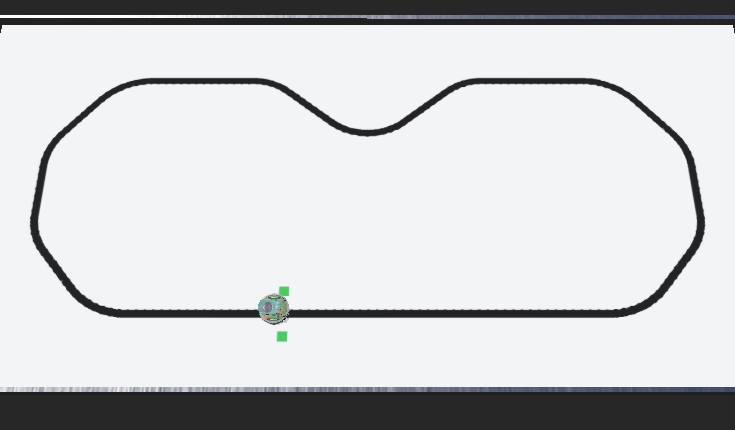
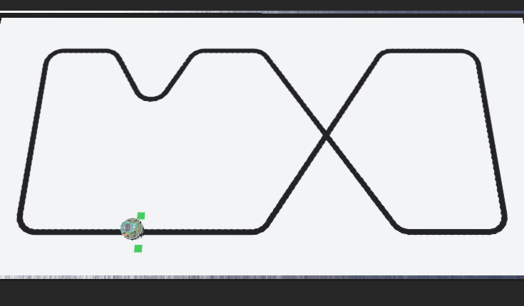

# Task 1: Line follower

[Wersja polska](README.md) · PDF: `line_follower_EN.pdf`



## Task description

An e-puck robot stands on a track with a black line. Write a program that makes the robot drive **one full lap** along the line, starting and finishing at the green start markers. Time matters.

There are two tracks:

- **Track 1 (easy)**, file `worlds/track_1.wbt`: about 4.2 m, gentle curves.
- **Track 2 (hard)**, file `worlds/track_2.wbt`: about 5.5 m, sharp turns, a V-shaped zigzag and a crossing where the robot has to go straight.

The same program should complete both tracks without changes.



## Folder structure

```
01_line_follower/
├── worlds/
│   ├── track_1.wbt                        track 1
│   ├── track_2.wbt                        track 2
│   └── textures/                          track images
└── controllers/
    ├── line_follower/line_follower.py     YOUR PROGRAM
    └── judge/                             judge (do not modify)
```

## The robot

The e-puck robot has two motor-driven wheels and three ground sensors at the front.

- `left wheel motor`, `right wheel motor`: wheel motors. The program sets their angular velocity, at most 6.28 rad/s (about 13 cm/s).
- `gs0` (left), `gs1` (centre), `gs2` (right): ground sensors, 1 cm apart, about 3 cm in front of the wheel axle. They return about **300 on the black line** and about **750 on the white floor**. Intermediate values appear only right at the edge of the line, so in practice each sensor says "line" or "no line".
- The line is 2 cm wide. When the robot drives exactly along the middle, the centre sensor sees the line and the side sensors see the white floor.

The skeleton in `line_follower.py` already sets up the motors and sensors. For now the robot just drives straight. Your job is to fill in the part marked `TODO`.

## Rules and evaluation

The judge (robot "judge") tracks the e-puck position and prints the results in the console.

- A lap counts when the robot drives the whole track in the right direction and comes back to the start. Shortcuts are not counted.
- If the robot moves away from the line (more than 6 cm) for longer than 3 s, the attempt is over.
- Time limit: 180 s per lap.
- The score is the lap time. The number of completed tracks counts first, then the sum of the times.

Levels:

- **basic**: complete track 1,
- **full**: complete both tracks,
- **extra**: get the best times. For reference, our solution drives track 1 in about 47 s and track 2 in about 60 s.

## Hints

- Start by printing the sensor values in the console (the `print` line in the skeleton is commented out) and watch how they change in the curves.
- The simplest approach: if the left sensor sees the line, turn left; if the right one does, turn right. A better one: a proportional (P) or PD controller, where the turning strength depends on the error.
- Think about what the robot should do when no sensor sees the line (e.g. after a too fast turn) and when all of them do (the crossing).
- Speed is a trade-off: slow down in the curves, speed up on the straights.

## What to submit

- your controller file (`.py`),
- a short screen recording (up to 2 minutes) showing the robot in action and the judge's result in the console,
- a few sentences of description: how your solution works, what was difficult and what you would improve with more time.

Send your solution in the way given by the recruitment organisers. You may use the documentation, the internet and AI tools, but during the interview we will ask you to explain your code, so make sure you understand every line of it.

Do not modify the judge or world files (except for your own experiments). We will run your controller in the original worlds during the evaluation.

## Webots: what it is and how to start

### What is Webots

Webots is a free, open-source robot simulator developed by Cyberbotics. It lets you build a virtual world with robots, sensors and objects, and control the robots with programs (called controllers) written in Python, C, C++ and other languages. The simulation includes physics: friction, masses, collisions and sensor noise, so a program that works in Webots behaves similarly on a real robot. This way you can learn robotics without any hardware.

### Installation

1. Download **Webots R2025a** from https://cyberbotics.com (Download button) or from https://github.com/cyberbotics/webots/releases. The tasks were prepared and tested with this version.
2. Install it like a regular application (Windows: `.exe` installer, macOS: `.dmg` file, Linux: `.deb` package or `snap`).
3. Install **Python 3** (https://www.python.org). On Windows, tick "Add Python to PATH" in the installer.
4. If Webots does not find Python by itself, set it in *Tools → Preferences → General → Python command* (e.g. `python` or the full path to `python.exe`).

### Running a task for the first time

1. Download this repository (`git clone` or *Code → Download ZIP*) and unpack it in a normal folder, e.g. `C:\robotics\`. **Do not** put it inside the Webots installation folder (`C:\Program Files\Webots`) or in a folder synchronised with OneDrive.
2. In Webots choose *File → Open World* and open the `.wbt` file from the `worlds` folder of the chosen task.
3. The first time a world is opened, Webots downloads the robot models from the internet, so you need a network connection. This may take a moment.
4. Start the simulation with the play button (▶), pause it with the pause button, and the reset button (circular arrow) restores the initial state.
5. Messages from the programs, including the judge's result, appear in the console at the bottom of the window.

### How to edit the robot program

The controller code is in `controllers/<name>/<name>.py`. You can edit it in the built-in Webots editor (right-click the robot → *Edit controller*) or in any editor, e.g. VS Code. After saving your changes, reset the simulation so the program starts again.

Useful resources:

- Webots user guide: https://cyberbotics.com/doc/guide/index
- function reference (API): https://cyberbotics.com/doc/reference/index (switch the example language to Python)
- beginner tutorials: https://cyberbotics.com/doc/guide/tutorials

### Common problems

- **"Skipped unknown … node or PROTO"** or **"changed by fallback mechanism"**: Webots cannot download the models. Check your internet connection and make sure the project is not inside the Webots installation folder.
- **The controller does not start, Python error**: check the *Python command* setting in the preferences.
- **Code changes have no effect**: save the file and reset the simulation.
- **The simulation is slow**: disable shadows and anti-aliasing in *Tools → Preferences → OpenGL* or use the fast mode (double-arrow *Fast* button).
