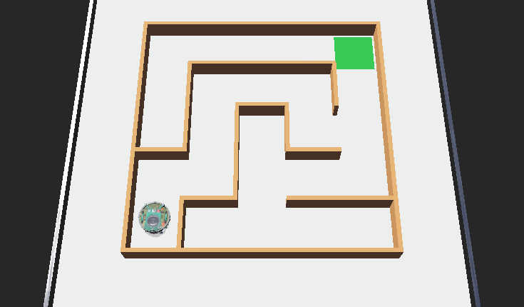
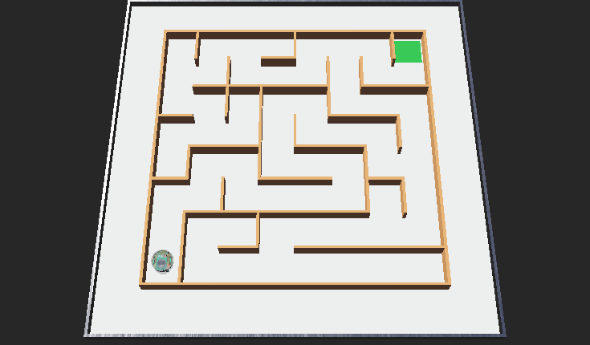

# Recruitment task: Maze

[Wersja polska](README.md) · PDF: `maze_EN.pdf`



## Getting started

This is one of the recruitment tasks for the software section. You solve it on your own in the **Webots** robot simulator and write the program in **Python**. You do not need to know Webots beforehand: everything you need is in this description. The task comes with a ready simulation world, a program skeleton and a judge that measures the result automatically.

1. Install Webots R2025a and Python 3 (see "Webots: what it is and how to start" at the end of this description).
2. Unpack the whole task folder in a normal folder, outside the Webots installation folder and outside OneDrive.
3. Read the task description below.
4. Open a world from the `worlds` folder in Webots and start writing code in `maze_solver.py`.
5. Send your finished solution by e-mail (see "How to submit your solution").

## Task description

An e-puck robot starts in a corner of a maze. Write a program that takes it to the **green goal area** as fast as possible without touching the walls.

There are two mazes:

- **Maze 1 (easy)**, file `worlds/maze_1.wbt`: 5 × 5 cells.
- **Maze 2 (hard)**, file `worlds/maze_2.wbt`: 8 × 8 cells.

The same program should solve both mazes without changes.



## Folder structure

```
maze/
├── worlds/
│   ├── maze_1.wbt
│   └── maze_2.wbt
└── controllers/
    ├── maze_solver/maze_solver.py   YOUR PROGRAM
    └── judge/                       judge (do not modify)
```

## The robot and the maze

- Maze cells are 12 × 12 cm, walls are 1 cm thick and 5 cm high. The robot is about 7 cm in diameter, so there is less than 2 cm of space on each side.
- `left wheel motor`, `right wheel motor`: wheel motors, at most 6.28 rad/s.
- `left wheel sensor`, `right wheel sensor`: wheel encoders (wheel rotation in radians). Wheel radius is 2.05 cm, the distance between the wheels is 5.2 cm. It is worth calibrating these values in the simulation, because the robot turns a bit less than the calculation suggests.
- `ps0` … `ps7`: infrared distance sensors around the robot. `ps0` and `ps7` look forward, `ps2` to the right, `ps5` to the left, `ps1` and `ps6` diagonally forward, `ps3` and `ps4` backwards.
- Approximate readings with the robot in the middle of a cell: about **65–75 with no wall**, about **150–170 with a wall at the side**, about **110–140 with a wall in front**. The closer the wall, the higher the value. The sensors are noisy.
- `gs0`, `gs1`, `gs2`: ground sensors. The green goal area is darker than the floor (the reading drops below about 600), so the robot can tell that it has arrived.

## Rules and evaluation

- The judge measures the time from the start until the centre of the robot is on the green area.
- Every wall touch adds a **2 s penalty**.
- Time limit: 180 s for maze 1 and 300 s for maze 2.
- The score is the time plus penalties. The number of solved mazes counts first, then the sum of the scores.

Levels:

- **basic**: solve maze 1,
- **full**: solve both mazes,
- **extra**: in maze 2 the "follow the right (or left) wall" method drives through 62 cells, while the shortest path has only 30. Try to find a faster way, e.g. by mapping the maze while driving and planning the route (flood fill, BFS). For reference, our wall-following solution solves maze 1 in about 58 s and maze 2 in about 135 s.

## Hints

- Start by printing the sensor values in the console and check what they look like with and without a wall.
- The simplest strategy is the right-hand rule: if there is no wall on the right, turn right; if there is a wall in front, turn left; in a dead end, turn around.
- Driving "cell by cell" (exactly 12 cm forward, turning exactly 90°) is usually more reliable than continuous driving. Use the encoders to measure distances and angles.
- Heading errors add up. Use the walls to correct them: keep an equal distance from the side walls, and when facing a wall, square up to it with the front sensors.
- The sensor readings are noisy, so it is worth averaging a few measurements before making a decision.

## How to submit your solution

Send your solution by e-mail to **selim.mucharski.stud@pw.edu.pl**.

E-mail **subject**: `[Rekrutacja] maze - Name Surname`

**Attachment**: a ZIP file named `name_surname_maze.zip`, containing:

- your controller file (`maze_solver.py`) and any additional `.py` files it uses,
- a `README.md` (or `.txt`) file with a few sentences of description: how your solution works, what was difficult and what you would improve with more time.

In the e-mail **body** give:

- your name and surname,
- contact: your Discord nickname (and an e-mail address, if it differs from the one you are writing from),
- your field and year of study,
- which task the solution is for (Maze) and which levels you completed,
- the results from the judge console (e.g. lap times),
- a link to a short screen recording (up to 2 minutes, e.g. an unlisted YouTube video or a Google Drive file shared by link) showing the robot in action and the judge's result.

Do not attach the recording itself, as it may be too large. If your e-mail service blocks the ZIP attachment, upload it to Google Drive or OneDrive and send the link.

### Rules

You may use the documentation, the internet and AI tools, but during the interview we will ask you to explain your code, so make sure you understand every line of it. Do not modify the judge or world files (except for your own experiments). We will run your controller in the original worlds during the evaluation.

## Contact

- solutions: e-mail **selim.mucharski.stud@pw.edu.pl**
- questions and technical problems: Discord, **Selim Mucharski**: https://discordapp.com/users/519631917444890624

## Webots: what it is and how to start

### What is Webots

Webots is a free, open-source robot simulator developed by Cyberbotics. It lets you build a virtual world with robots, sensors and objects, and control the robots with programs (called controllers) written in Python, C, C++ and other languages. The simulation includes physics: friction, masses, collisions and sensor noise, so a program that works in Webots behaves similarly on a real robot. This way you can learn robotics without any hardware.

### Installation

1. Download **Webots R2025a** from https://cyberbotics.com (Download button) or from https://github.com/cyberbotics/webots/releases. The tasks were prepared and tested with this version.
2. Install it like a regular application (Windows: `.exe` installer, macOS: `.dmg` file, Linux: `.deb` package or `snap`).
3. Install **Python 3** (https://www.python.org). On Windows, tick "Add Python to PATH" in the installer.
4. If Webots does not find Python by itself, set it in *Tools → Preferences → General → Python command* (e.g. `python` or the full path to `python.exe`).

### Running a task for the first time

1. Unpack the task folder (as a whole, together with the `worlds` and `controllers` subfolders) in a normal folder, e.g. `C:\robotics\`. **Do not** put it inside the Webots installation folder (`C:\Program Files\Webots`) or in a folder synchronised with OneDrive.
2. In Webots choose *File → Open World* and open the `.wbt` file from the `worlds` folder of the chosen task.
3. The first time a world is opened, Webots downloads the robot models from the internet, so you need a network connection. This may take a moment.
4. Start the simulation with the play button (▶), pause it with the pause button, and the reset button (circular arrow) restores the initial state.
5. Messages from the programs, including the judge's result, appear in the console at the bottom of the window.

### How to edit the robot program

The controller code is in `controllers/<name>/<name>.py`. You can edit it in the built-in Webots editor (right-click the robot → *Edit controller*) or in any editor, e.g. VS Code. After saving your changes, reset the simulation so the program starts again.

Useful resources:

- Webots user guide: https://cyberbotics.com/doc/guide/index
- function reference (API): https://cyberbotics.com/doc/reference/index (switch the example language to Python)
- beginner tutorials: https://cyberbotics.com/doc/guide/tutorials

### Common problems

- **"Skipped unknown … node or PROTO"** or **"changed by fallback mechanism"**: Webots cannot download the models. Check your internet connection and make sure the project is not inside the Webots installation folder.
- **The controller does not start, Python error**: check the *Python command* setting in the preferences.
- **Code changes have no effect**: save the file and reset the simulation.
- **The simulation is slow**: disable shadows and anti-aliasing in *Tools → Preferences → OpenGL* or use the fast mode (double-arrow *Fast* button).
