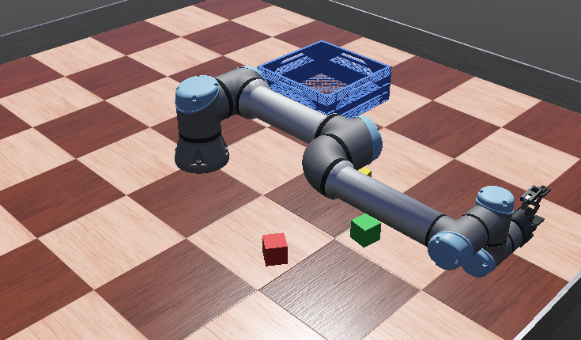

# Recruitment task: Pick and place

[Wersja polska](README.md) · PDF: `pick_and_place_EN.pdf`



## Getting started

This is one of the recruitment tasks for the software section. You solve it on your own in the **Webots** robot simulator and write the program in **Python**. You do not need to know Webots beforehand: everything you need is in this description. The task comes with a ready simulation world, a program skeleton and a judge that measures the result automatically.

1. Install Webots R2025a and Python 3 (see "Webots: what it is and how to start" at the end of this description).
2. Unpack the whole task folder in a normal folder, outside the Webots installation folder and outside OneDrive.
3. Read the task description below.
4. Open a world from the `worlds` folder in Webots and start writing code in `pick_and_place.py`.
5. Send your finished solution by e-mail (see "How to submit your solution").

## Task description

In front of you is a **Universal Robots UR5e** arm with a **Robotiq 2F-85** gripper. Three cubes (red, green and yellow) lie on the floor. Write a program that moves them into the blue crate.

World: `worlds/pick_and_place.wbt`.

## Folder structure

```
pick_and_place/
├── worlds/pick_and_place.wbt
└── controllers/
    ├── pick_and_place/
    │   ├── pick_and_place.py      YOUR PROGRAM
    │   └── ur5e_kinematics.py     arm kinematics (no need to change it)
    └── judge/judge.py             judge (do not modify)
```

## Controlling the arm

You do not need to compute joint angles. The skeleton has a ready-made function that takes the **position and orientation of the gripper** and computes the joint angles by itself (inverse kinematics, file `ur5e_kinematics.py`):

```
move_to_pose(x, y, z, roll=0, pitch=0, yaw=0, linear=False)
```

- `x, y, z` is the position of the grasp point (between the fingertips) in metres. The origin is at the base of the robot on the floor: X forward, Y to the left, Z up.
- `roll, pitch, yaw` is the gripper orientation in radians. With `roll = pitch = yaw = 0` the gripper points straight down and the fingers close along the X axis. `yaw` turns the gripper around the vertical axis, `roll` and `pitch` tilt it. For this task `yaw` alone is usually enough.
- `linear=True` makes the gripper move along a straight line (in 1 cm steps). It is useful when going down to a cube and lifting it, so the fingers do not hit the cube.
- The function returns `False` if the pose is out of reach.

Other ready-made functions: `move_to(angles)` (sets the 6 joints directly), `open_gripper()`, `close_gripper()`, `wait(seconds)`, `current_position()` (current grasp point position) and `current_angles()`.

The `CUBES` dictionary holds the centre of each cube and its rotation around the vertical axis (`yaw`). The cubes are 5 cm wide. If you give the gripper the same `yaw` as the cube, the fingers will be parallel to its faces. The crate centre is in `CRATE_CENTER`, and its walls are 12 cm high.

The skeleton already contains an example: moving 15 cm above the red cube.

## Rules and evaluation

Every second, the judge checks how many cubes are inside the crate. The evaluation ends when all cubes are in the crate or after 120 s of simulation time. The number of cubes counts first, then the time.

Levels:

- **basic**: move the red cube,
- **full**: move all three cubes,
- **extra**: the program works for any cube positions and is as fast as possible. For this level we will change the cube positions and rotations (in the world and in the `CUBES` dictionary), so do not hard-code the coordinates. For reference, our solution moves all cubes in about 21 s.

## Hints

- A typical sequence for one cube: above the cube, go down, close the gripper, lift, move above the crate, open the gripper.
- Grasp the cube a bit above its centre (e.g. 1 cm), so the fingers do not hit the floor.
- Keep the cube high (e.g. 30 cm) when moving it above the crate, so it does not catch on the crate wall.
- The cubes are symmetric, so a 90° turn (`yaw ± π/2`) works too. Sometimes this avoids a large wrist rotation.
- If you want to understand how inverse kinematics works, look into `ur5e_kinematics.py`. The numerical method (damped least squares) is described there in the comments.

## How to submit your solution

Send your solution by e-mail to **selim.mucharski.stud@pw.edu.pl**.

E-mail **subject**: `[Rekrutacja] pick_and_place - Name Surname`

**Attachment**: a ZIP file named `name_surname_pick_and_place.zip`, containing:

- your controller file (`pick_and_place.py`) and any additional `.py` files it uses,
- a `README.md` (or `.txt`) file with a few sentences of description: how your solution works, what was difficult and what you would improve with more time.

In the e-mail **body** give:

- your name and surname,
- contact: your Discord nickname (and an e-mail address, if it differs from the one you are writing from),
- your field and year of study,
- which task the solution is for (Pick and place) and which levels you completed,
- the results from the judge console (e.g. lap times),
- a link to a short screen recording (up to 2 minutes, e.g. an unlisted YouTube video or a Google Drive file shared by link) showing the robot in action and the judge's result.

Do not attach the recording itself, as it may be too large. If your e-mail service blocks the ZIP attachment, upload it to Google Drive or OneDrive and send the link.

### Rules

You may use the documentation, the internet and AI tools, but during the interview we will ask you to explain your code, so make sure you understand every line of it. Do not modify the judge or world files (except for your own experiments). We will run your controller in the original worlds during the evaluation.

## Contact

- solutions: e-mail **selim.mucharski.stud@pw.edu.pl**
- questions and technical problems: Discord, **Selim Mucharski**: https://discordapp.com/users/519631917444890624

## Webots: what it is and how to start

### What is Webots

Webots is a free, open-source robot simulator developed by Cyberbotics. It lets you build a virtual world with robots, sensors and objects, and control the robots with programs (called controllers) written in Python, C, C++ and other languages. The simulation includes physics: friction, masses, collisions and sensor noise, so a program that works in Webots behaves similarly on a real robot. This way you can learn robotics without any hardware.

### Installation

1. Download **Webots R2025a** from https://cyberbotics.com (Download button) or from https://github.com/cyberbotics/webots/releases. The tasks were prepared and tested with this version.
2. Install it like a regular application (Windows: `.exe` installer, macOS: `.dmg` file, Linux: `.deb` package or `snap`).
3. Install **Python 3** (https://www.python.org). On Windows, tick "Add Python to PATH" in the installer.
4. If Webots does not find Python by itself, set it in *Tools → Preferences → General → Python command* (e.g. `python` or the full path to `python.exe`).

### Running a task for the first time

1. Unpack the task folder (as a whole, together with the `worlds` and `controllers` subfolders) in a normal folder, e.g. `C:\robotics\`. **Do not** put it inside the Webots installation folder (`C:\Program Files\Webots`) or in a folder synchronised with OneDrive.
2. In Webots choose *File → Open World* and open the `.wbt` file from the `worlds` folder of the chosen task.
3. The first time a world is opened, Webots downloads the robot models from the internet, so you need a network connection. This may take a moment.
4. Start the simulation with the play button (▶), pause it with the pause button, and the reset button (circular arrow) restores the initial state.
5. Messages from the programs, including the judge's result, appear in the console at the bottom of the window.

### How to edit the robot program

The controller code is in `controllers/<name>/<name>.py`. You can edit it in the built-in Webots editor (right-click the robot → *Edit controller*) or in any editor, e.g. VS Code. After saving your changes, reset the simulation so the program starts again.

Useful resources:

- Webots user guide: https://cyberbotics.com/doc/guide/index
- function reference (API): https://cyberbotics.com/doc/reference/index (switch the example language to Python)
- beginner tutorials: https://cyberbotics.com/doc/guide/tutorials

### Common problems

- **"Skipped unknown … node or PROTO"** or **"changed by fallback mechanism"**: Webots cannot download the models. Check your internet connection and make sure the project is not inside the Webots installation folder.
- **The controller does not start, Python error**: check the *Python command* setting in the preferences.
- **Code changes have no effect**: save the file and reset the simulation.
- **The simulation is slow**: disable shadows and anti-aliasing in *Tools → Preferences → OpenGL* or use the fast mode (double-arrow *Fast* button).
